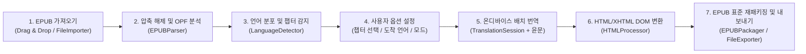

# EPUB Intelligence Translator — 제품 및 아키텍처 정의서

## 1. 앱 개요 및 핵심 목적 (Vision & Purpose)

**EPUB Intelligence Translator**는 전자책(EPUB) 파일의 **원본 구조, 스타일(CSS), 이미지, 목차(TOC), 메타데이터를 100% 그대로 유지**하면서, Apple의 온디바이스 AI(`Translation` 및 `NaturalLanguage` 프레임워크)를 활용해 본문을 번역해 주는 **macOS용 전자책 번역 도구(향후 iOS/iPadOS 유니버설 앱 확장 고려)**입니다.

### 핵심 가치
1. **원본 레이아웃 완벽 보존 (Zero-Destruction Structure)**
   - 기존 EPUB의 디렉토리 구조(`META-INF`, `OEBPS`), 폰트, 이미지, 스타일시트(CSS), OPF/NCX 목차 구조를 훼손하지 않고 텍스트 노드만 정교하게 가공 후 표준 EPUB 규격(비압축 `mimetype` 선두 배치 등)으로 재패키징합니다.
2. **유연한 읽기 경험 (3가지 번역 모드)**
   - **이중 언어 (Bilingual)**: 원문 문단 바로 아래에 번역문 문단을 나란히 삽입하여 원서 대조 독서 및 어학 학습에 최적화합니다.
   - **번역문 대체 (Replace)**: 원문을 번역문으로 완전히 치환하여 일반 번역서처럼 읽을 수 있게 합니다.
   - **주석/토글형 (Annotated)**: 본문에는 번역문을 표시하고, `
/
` 태그를 통해 클릭 시 원문을 펼쳐 볼 수 있게 합니다.
3. **100% 온디바이스 프라이버시 & 무료 무제한 번역**
   - 외부 클라우드 API(유료 토큰)를 쓰지 않고 Apple Silicon Neural Engine(ANE) 기반의 `Translation` 프레임워크를 사용하여, 저작권이나 개인정보 유출 걱정 없이 오프라인에서도 안전하고 빠르게 번역합니다.
4. **스마트 언어 감지 (Smart Skipping)**
   - `NaturalLanguage` 프레임워크로 문단별 언어를 분석해, 이미 목표 언어로 작성된 문단이나 숫자/기호만 있는 문단은 자동으로 건너뛰어 불필요한 번역을 방지합니다.
5. **macOS & iOS/iPadOS 크로스 플랫폼 지향**
   - SwiftUI, `@Observable`, Swift Concurrency(`async/await`, `actor`), Apple 기본 프레임워크(`Translation`, `NaturalLanguage`) 및 순수 Swift 패키지(`ZIPFoundation`, `SwiftSoup`)로 구성되어 있어 iOS/iPadOS로의 전환이 용이합니다.

---

## 2. 주요 워크플로우 (Core Workflow)

---

## 3. 시스템 아키텍처 (System Architecture)

| 계층 | 주요 컴포넌트 | 역할 및 책임 | 플랫폼 의존성 |
| :--- | :--- | :--- | :--- |
| **App / UI** | `EPUBTranslatorApp`, `ContentView`, `FileDropView`, `ChapterListView`, `SettingsPanel`, `ProgressDashboard` | 사용자 인터페이스, 파일 드롭/선택, `.translationTask` 세션 바인딩, 진행률 시각화 | SwiftUI (일부 `NSColor`, `NSCursor`, `HSplitView` 사용 — iOS 전환 시 분기 필요) |
| **ViewModel** | `TranslatorViewModel` (`@Observable`, `@MainActor`) | 앱 상태(`AppPhase`) 관리, 파싱/언어감지/번역/패키징 파이프라인 오케스트레이션 | Foundation, SwiftUI, Translation |
| **Models** | `EPUBBook`, `Chapter`, `TranslationMode`, `TargetLanguage`, `AppPhase` | 도메인 데이터 모델 및 상태 정의 (`Sendable`) | Foundation (100% 플랫폼 독립) |
| **Services** | `EPUBParser` (`actor`) | EPUB 압축 해제, `container.xml` 및 `.opf` 파싱, 스파인(Spine) 순서대로 챕터 추출 | Foundation, ZIPFoundation, SwiftSoup |
| | `LanguageDetector` | 문서 전체 언어 분포 계산(병렬 TaskGroup) 및 문단별 번역 스킵 여부 판별 | Foundation, NaturalLanguage |
| | `TranslationService` | `TranslationSession`을 통한 문단 배치 번역 수행 | Foundation, Translation |
| | `HybridIntelligenceService` | 번역된 텍스트의 문장부호 및 타이포그래피 후처리(윤문) | Foundation |
| | `HTMLProcessor` | XHTML/HTML에서 번역 대상 추출, 모드별 DOM 조작 및 CSS 주입, XML 엔티티 정규화 | Foundation, SwiftSoup |
| | `EPUBPackager` | EPUB 표준(`mimetype` 무압축 제1엔트리)을 준수하여 ZIP 아카이브 생성 | Foundation, ZIPFoundation |
| | `NetworkMonitor`, `AppleSiliconDetector` | 온디바이스/오프라인 상태 안내 및 하드웨어 아키텍처 정보 표시 | Network, Darwin (`sysctlbyname`) |

---

## 4. iOS / iPadOS 확장 전략 (Cross-Platform Roadmap)

- **공유 코어 (Shared Core - 90% 이상 재사용)**
  - `Models` 및 `Services` 계층은 macOS 전용 UI 프레임워크(AppKit)에 의존하지 않으므로 그대로 iOS/iPadOS 타겟과 공유 가능합니다.
  - `Translation`, `NaturalLanguage`, `ZIPFoundation`, `SwiftSoup` 모두 iOS 18.0+ / macOS 15.0+ 에서 동일하게 동작합니다.
- **UI/플랫폼 분기 포인트**
  - 색상: `Color(nsColor:)` → Asset Catalog 컬러 또는 플랫폼 분기 헬퍼로 추상화.
  - 레이아웃: macOS의 `HSplitView` 및 고정 윈도우 크기 → iOS/iPadOS에서는 `NavigationSplitView` 또는 `TabView` / `ViewThatFits`를 활용한 적응형 레이아웃으로 전환.
  - 인터랙션: `NSCursor` 호버 효과 및 `.toggleStyle(.checkbox)` → `#if os(macOS)` 조건부 컴파일 처리.
  - 하드웨어 감지: `sysctlbyname("machdep.cpu.brand_string")`는 macOS 전용이므로 iOS 기기 모델명(`UIDevice`)과 분기 처리.
