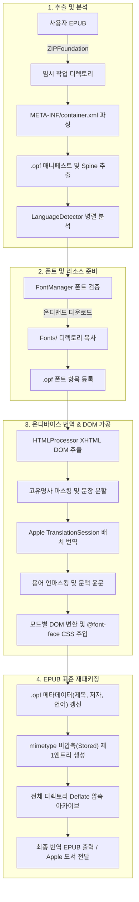

# 시스템 설계 및 데이터 파이프라인 (System Design)

EPUB Intelligence Translator는 표준 EPUB 2/3 규격을 준수하며, 원본 구조를 훼손하지 않는 비파괴적(Zero-Destruction) 데이터 파이프라인으로 설계되었습니다.

---

## 데이터 파이프라인 흐름도

---

## 주요 엔지니어링 세부사항

### 1. 엄격한 EPUB 규격 준수 (`EPUBPackager`)
- EPUB 파일은 ZIP 규격 기반이지만, 표준 사양에 따라 **`mimetype` 파일이 아카이브의 반드시 첫 번째 엔트리(Entry 0)**여야 하며, **어떠한 압축도 되지 않은 비압축(Stored / Compression Method: None)** 상태여야 합니다.
- `EPUBPackager`는 `ZIPFoundation`을 직접 제어하여 이 엄격한 규격을 100% 준수합니다.

### 2. 챕터별 폰트 상대 경로 정밀 산출
- EPUB 도서마다 내부 폴더 구조가 상이합니다 (예: `OEBPS/Text/ch01.xhtml` vs `OPS/ch01.html`).
- `HTMLProcessor.relativePath(from:to:)` 알고리즘이 챕터 파일의 디렉터리 경로와 `Fonts/` 디렉터리의 상대적 깊이를 자동 계산하여, `@font-face { src: url(...) }`이 어떤 구조에서도 정확히 폰트를 참조하도록 합니다.

### 3. XML 파서 호환성 보장
- 많은 EPUB 리더(특히 Apple Books)는 엄격한 XML 파서를 사용합니다.
- HTML 전용 특수 엔티티(예: `&nbsp;`, `&copy;`, `&mdash;` 등)가 XML DTD 없이 포함되면 파싱 크래시가 발생하므로, 모든 엔티티를 정규 수치 문자 참조(예: `&#160;`, `&#169;`, `&#8212;`)로 안전하게 치환합니다.
