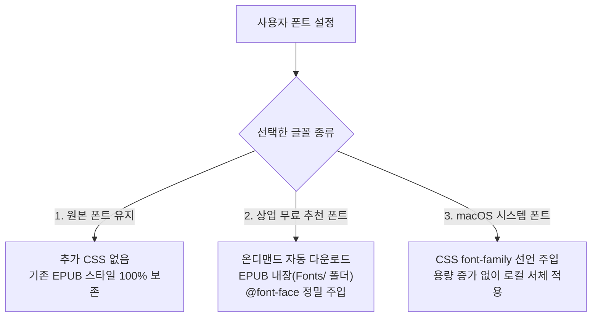

# 글꼴 및 타이포그래피 (Typography)

EPUB Intelligence Translator는 번역된 전자책의 심미성과 가독성을 극대화하기 위해 **지능형 하이브리드 글꼴 시스템**을 제공합니다.

기본적으로 원본 책의 고유 스타일을 존중하면서도, 사용자의 취향과 읽기 환경에 맞추어 **원문(언어별)과 번역문(도착 언어) 글꼴을 각각 독립적으로 커스터마이징**할 수 있습니다.

---

## 3가지 글꼴 선택 방식

### 1. 원본 폰트 유지 (Keep Original Font, 기본값)
- 원본 EPUB 도서에 지정된 CSS 서체 규칙 및 임베디드 폰트를 그대로 계승합니다.
- 추가적인 CSS 오버라이드를 하지 않아 출판사의 원래 디자인 의도를 가장 완벽하게 보존합니다.

### 2. 상업 무료 추천 폰트 (온디맨드 다운로드 & EPUB 완전 임베딩)
- **온디맨드 다운로드 (On-Demand Download)**:
  - 앱 번들 파일 크기를 가볍게 유지하기 위해, 사용자가 폰트를 **처음 선택하는 시점에 백그라운드로 안전하게 다운로드**되어 `Application Support/EPUBTranslator/Fonts/`에 캐시됩니다.
  - 한 번 다운로드된 폰트는 영구 보존되어 다음 번역 시 즉시 재사용됩니다.
- **EPUB 내부 정식 임베딩**:
  - 선택된 폰트 파일(`.otf`, `.ttf`, `.woff2`)을 EPUB 내부 `Fonts/` 폴더로 복사합니다.
  - `content.opf`의 `<manifest>`에 MIME 타입(`font/otf`, `font/ttf` 등)과 함께 정식 등록됩니다.
  - 챕터 XHTML 파일의 깊이에 맞추어 상대 경로(`../Fonts/...`)가 자동 계산된 `@font-face` 규칙이 주입됩니다.
  - **효과**: Apple Books, 스마트폰, 태블릿, 크레마/킨들 등 **어떤 뷰어나 기기에서 열어도 동일하게 미려한 서체로 렌더링**됩니다.
- **지원 및 권장 서체**:
  - **한국어 (`ko`)**:
    - **Pretendard (프리텐다드 고딕)**: 현대적이고 또렷한 본문용 산세리프 (SIL OFL)
    - **KoPubWorld 바탕 (명조)**: 한국전자출판협회 공식 전자책 표준 본문 명조체 (상업적 이용/임베딩 무료)
  - **다국어 (영문, 일본어, 중국어, 아랍어, 태국어 등)**:
    - **Noto Sans**: 영문, 유럽어, 키릴, 베트남어 등 글로벌 표준 본문 고딕 (SIL OFL)
    - **Noto Sans JP**: 일본어 전용 표준 본문 고딕 (SIL OFL)
    - **Noto Sans SC**: 중국어 간체 표준 본문 고딕 (SIL OFL)
    - **Noto Sans TC**: 중국어 번체 표준 본문 고딕 (SIL OFL)
    - **Noto Sans Arabic**: 아랍어 전용 표준 본문 고딕 (SIL OFL)
    - **Noto Sans Thai**: 태국어 전용 표준 본문 고딕 (SIL OFL)

### 3. macOS 시스템 설치 폰트 (System Fonts)
- 사용자 Mac의 서체 관리자(`NSFontManager`)에 설치된 수백 종의 시스템 폰트(예: Apple SD 산돌고딕 Neo, 바탕체, 나눔고딕, Helvetica 등)를 드롭다운에서 바로 선택할 수 있습니다.
- 폰트 파일 자체를 복제하지 않고 CSS `font-family` 규칙을 통해 연결되므로 EPUB 파일 용량이 늘어나지 않으며, Apple 기기 간에 쾌적하게 렌더링됩니다.

---

## 언어별 원문(Source)과 번역문(Target) 분리 적용

이중 언어 대조(Bilingual) 모드나 주석 토글(Annotated) 모드를 사용할 때, 원문과 번역문의 서체를 다르게 지정하면 시각적 대조 효과가 극대화됩니다.

- **원문 폰트 설정**:
  - 책에 포함된 출발 언어(예: English 95%, French 5%)를 감지하여 언어별로 각각 다른 서체를 부여할 수 있습니다.
  - 예: 영어 원문은 `Noto Sans` 고딕으로 지정하고, 원본 폰트는 보존.
- **번역문 폰트 설정**:
  - 선택된 도착 언어(예: 한국어)에 어울리는 서체를 독립적으로 지정합니다.
  - 예: 한국어 번역문은 `KoPubWorld 바탕(명조)` 또는 `Pretendard(고딕)`으로 지정.

---

## 실시간 타이포그래피 미리보기

글꼴 설정 카드 하단에는 현재 선택된 원문/번역문 서체로 렌더링된 실시간 샘플 문장이 표시됩니다. 다운로드 완료 여부 및 서체의 질감을 번역을 시작하기 전에 즉시 눈으로 확인할 수 있습니다.
